# Elektron Net: `elektron-net-wp` Repository Overview

- **Version:** 0.0.1 (draft)
- **Date:** October 13, 2026
- **Audience:** Site owners and developers who run or extend the Elektron Net WordPress presence
- **Reference implementation:** [`elektron-net`](https://github.com/kutlusoy/elektron-net) (`src/kernel/chainparams.cpp`, `doc-elektron/`), treat as ground truth for every protocol value shown on the site
- **Source:** [`elektron-net-wp`](https://github.com/kutlusoy/elektron-net-wp), WordPress theme and plugin for the Elektron Net web presence
- **Consumer:** [`elektron-net-mempool`](https://github.com/kutlusoy/elektron-net-mempool), the block explorer whose API supplies the live data
- **See also:** [`WHITEPAPER.md`](https://github.com/kutlusoy/elektron-net/blob/main/WHITEPAPER.md), [`BITCOIN_CORE_DIFF.md`](https://github.com/kutlusoy/elektron-net/blob/main/doc-elektron/BITCOIN_CORE_DIFF.md)

---

## 1. Contents

| Path | What it is |
|---|---|
| `themes/elektron/` | The **Elektron** theme: classic theme with block editor support, dark and light scheme, three.js hero, seven color themes with cyberpunk effects, front page and three page templates. |
| `plugins/elektron-live-blocks/` | The **Elektron Live Blocks** plugin: nine blocks and a shortcode that show live data from the explorer API. |
| `screenshots/` | Preview images taken from a real WordPress 7.1 installation. They are not part of either package. |
| `package.json` | Build tooling for the three.js hero bundle (development only). |

Both packages are installed separately. The theme works without the plugin. When the plugin is active, the theme reads its live data from it, so there is one explorer address and one cache.

## 2. Installation

1. Pack `themes/elektron` and `plugins/elektron-live-blocks` as separate zip files. The folder name inside the zip MUST stay `elektron` and `elektron-live-blocks`.
2. Upload the theme under Appearance > Themes > Add New > Upload Theme and activate it.
3. Upload the plugin under Plugins > Add New > Upload Plugin and activate it. The theme shows a dismissible notice that offers this step.
4. Create the pages yourself and pick the page templates **Protocol & Technology**, **Network** and **Build & Verify**. Without an assigned menu the theme lists them in the header automatically.

Requirements: WordPress 6.1 or newer for the plugin (6.0 for the theme), PHP 7.4 or newer.

## 3. Color themes and effects

The theme ships with seven color themes, each in a dark and a light variant, and three effect levels. The default is **Elektron Blue** with **Subtle** effects.

| Color theme | Idea |
|---|---|
| Elektron Blue | The blue of the logo, the default |
| Neon Grid | Cyan and magenta on near black, the classic cyberpunk look |
| Synthwave | Hot pink, violet and amber, a retro sunset |
| Matrix | Terminal green on black |
| Rust | Rusty orange and brass on burnt brown, post-apocalyptic |
| Iron | Steel and graphite with hazard amber |
| Violet Night | Soft violet and pink, inspired by popular editor themes |

| Effect level | What it adds |
|---|---|
| Off | Clean surfaces only |
| Subtle | Neon glow, HUD corner brackets on cards, a faint perspective grid in the hero, a glowing accent line under section titles |
| Full cyberpunk | Everything in Subtle, plus scanlines and vignette, a moving grid floor, a glitch on the headline, angular cut corners, the Orbitron and Share Tech Mono fonts |

Site owners pick the defaults under Appearance > Customize > Theme Options. Visitors can switch the color theme and the effects with the palette button in the header, and the choice is remembered in their browser. All animation stops for visitors who prefer reduced motion. When live data is available, a HUD status bar above the header shows block height, hash rate, fee and adjustment progress. The Elektron Live Blocks plugin picks up the active color theme automatically.

### Elektron Blue (default)

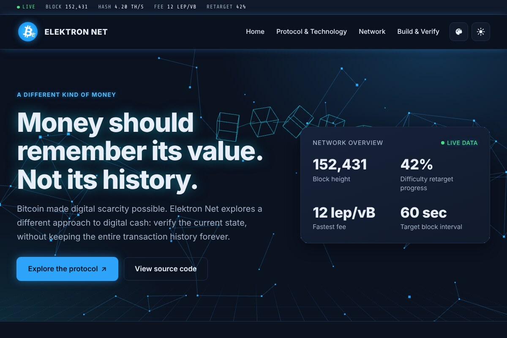

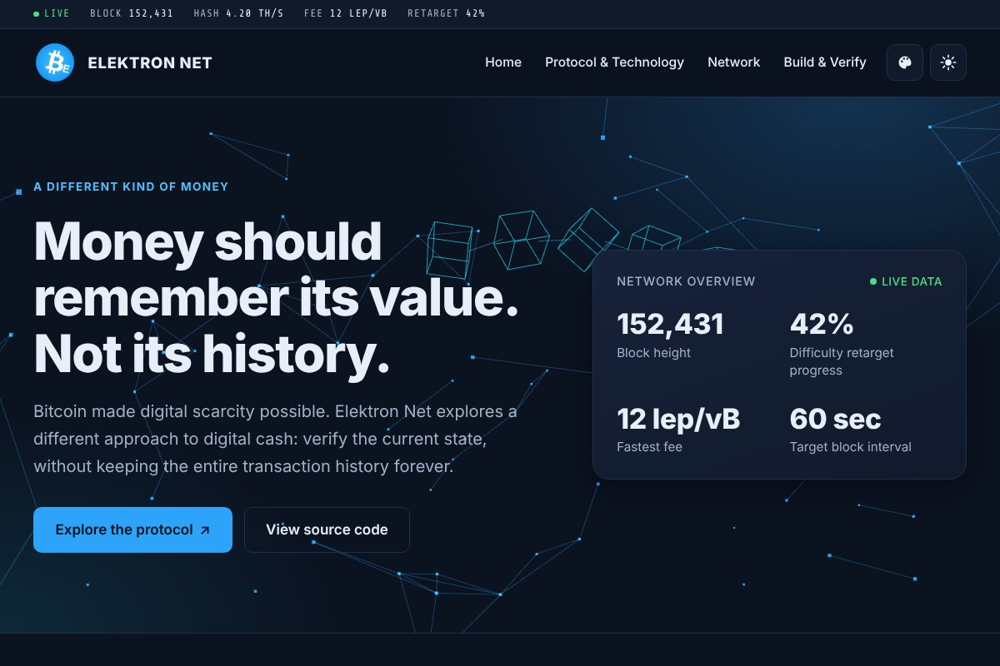

### Neon Grid

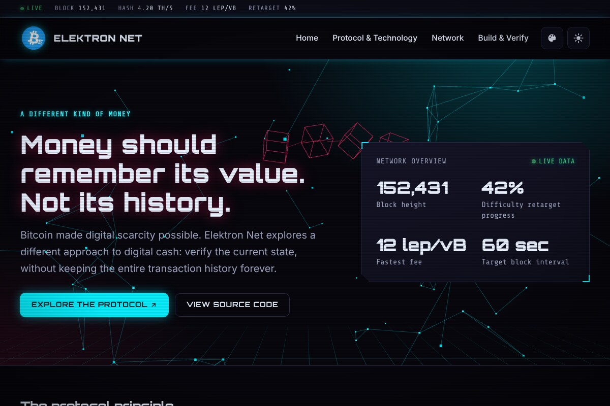

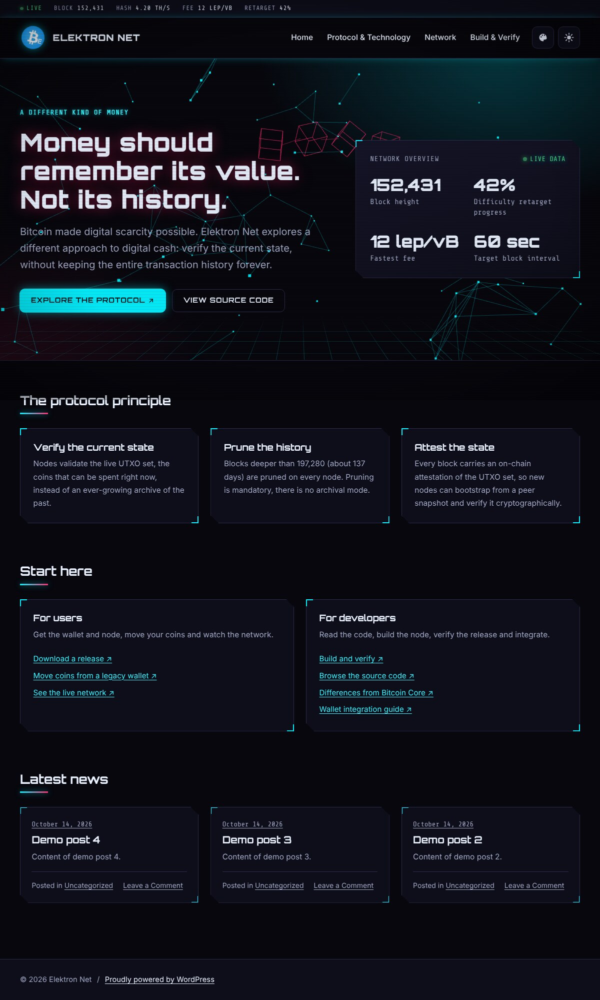

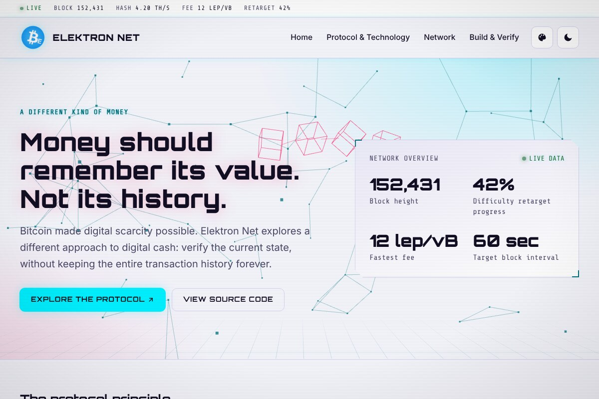

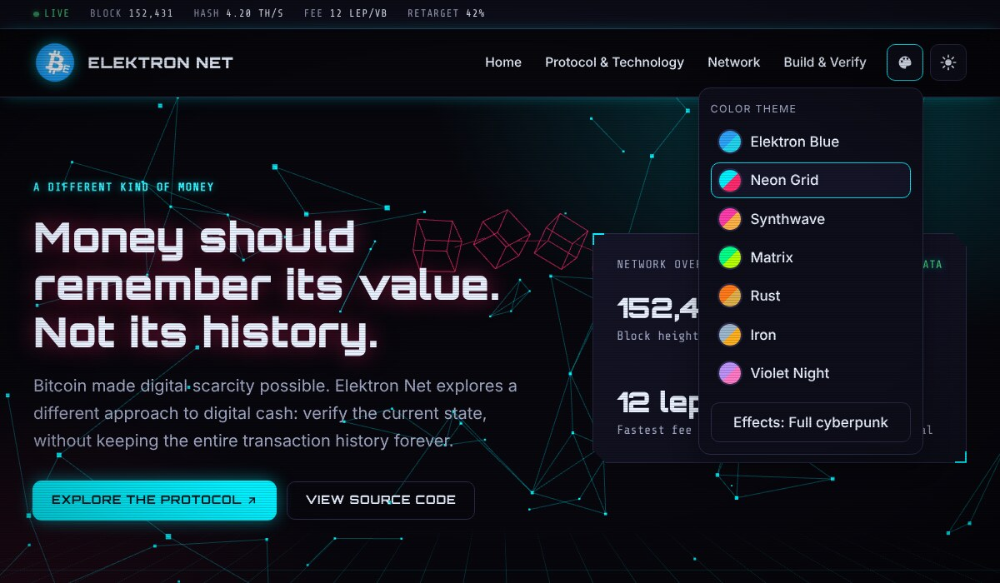

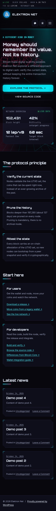

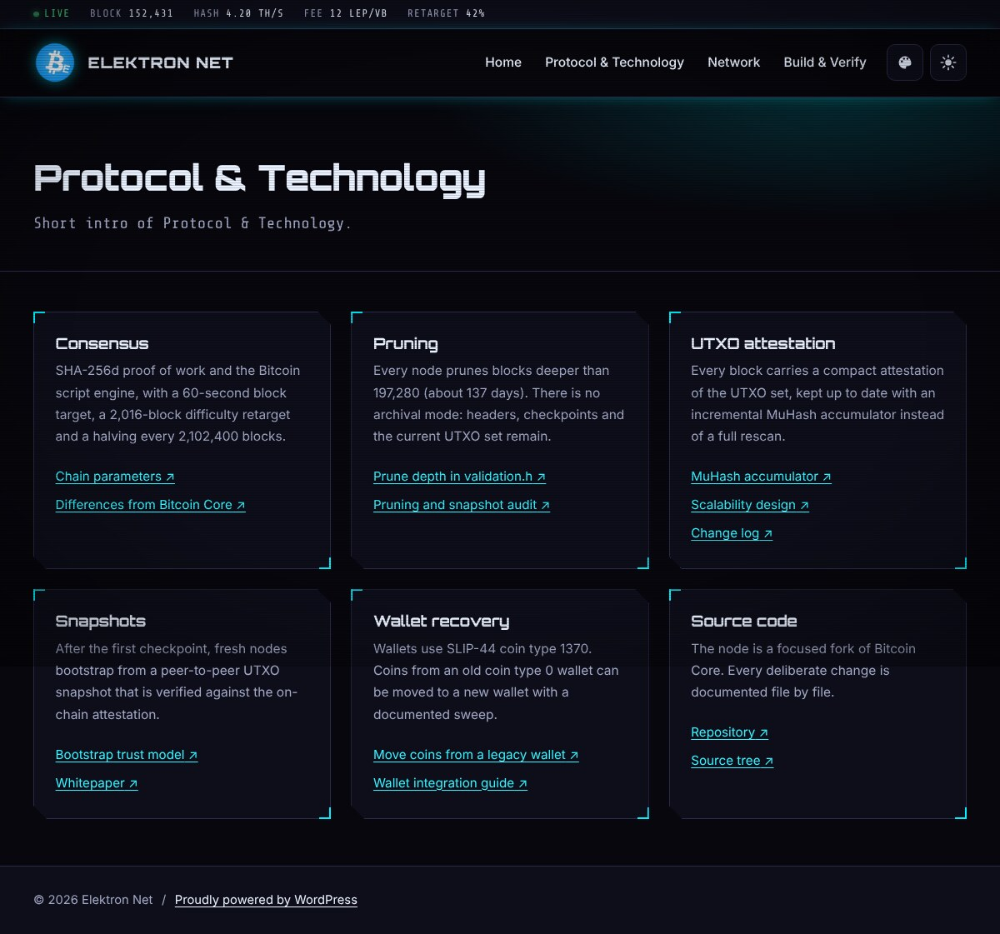

### Synthwave

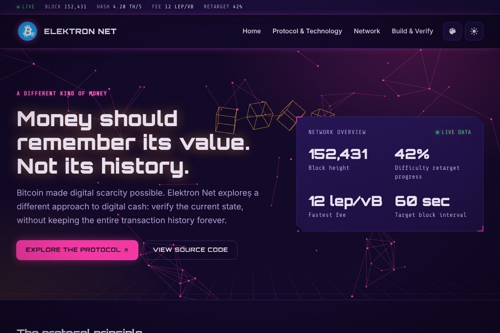

### Matrix

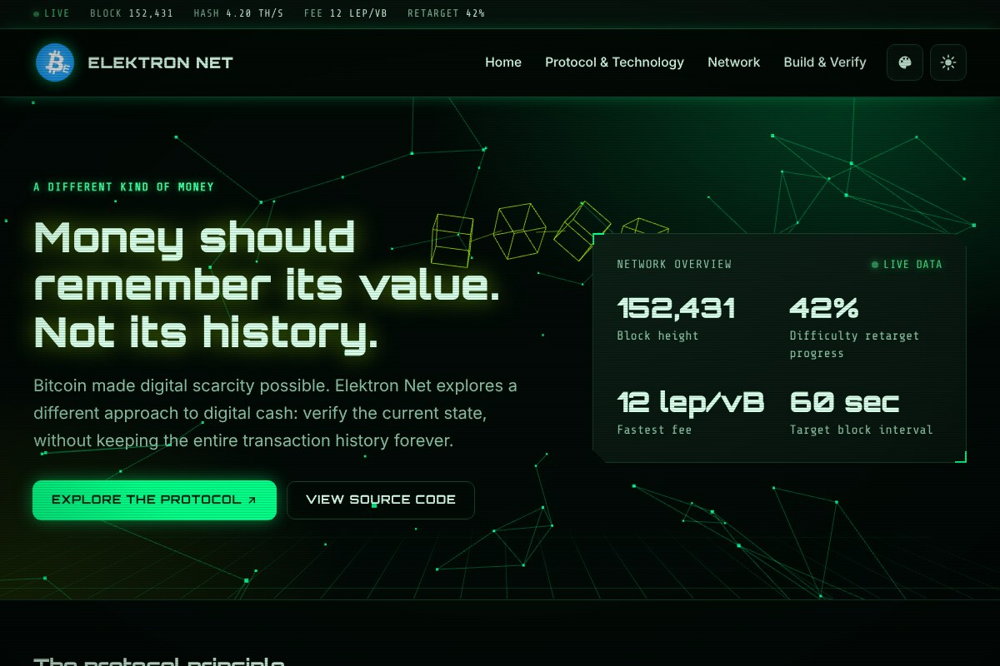

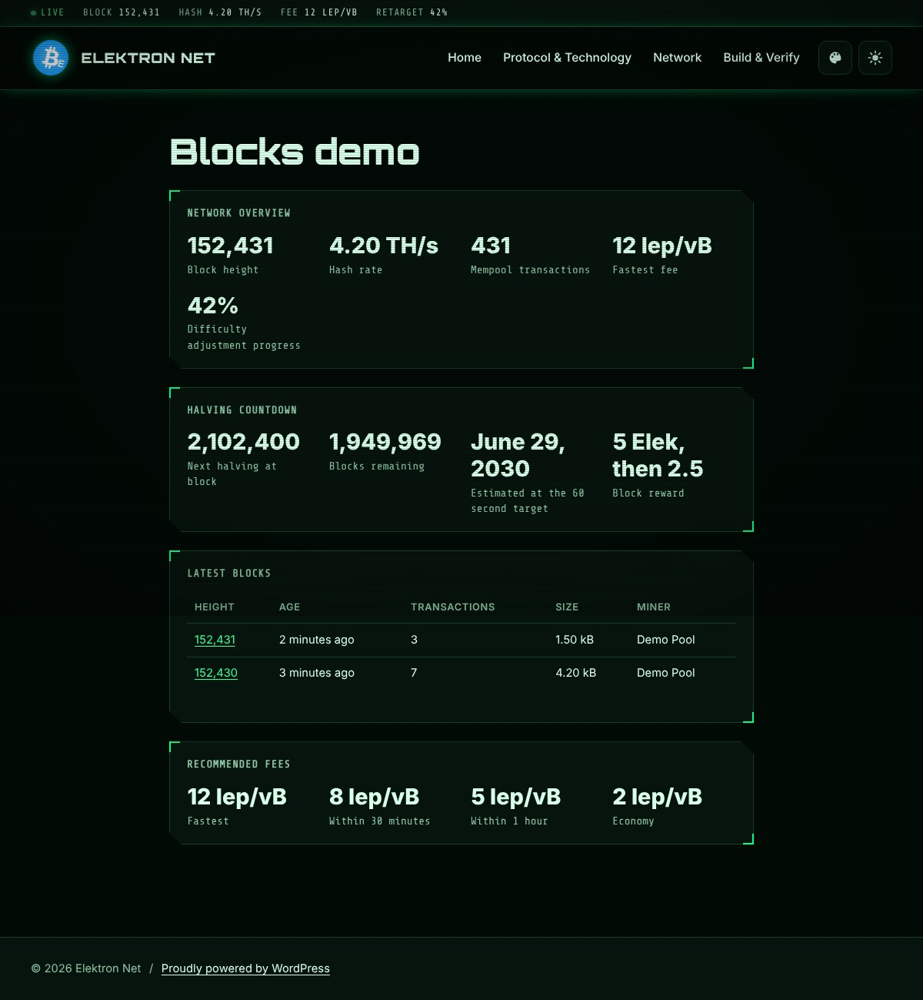

### Rust

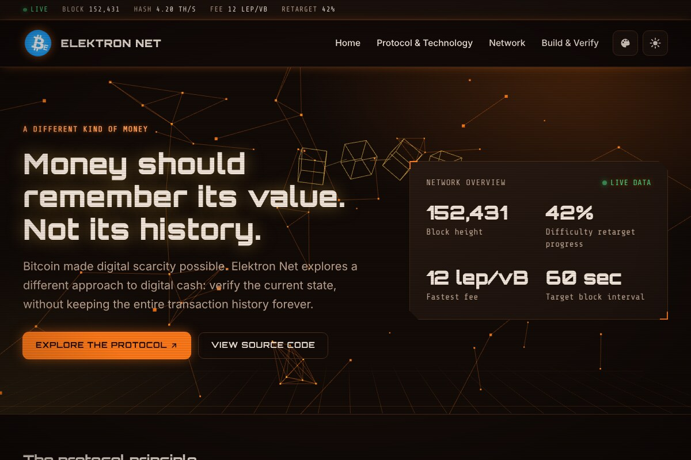

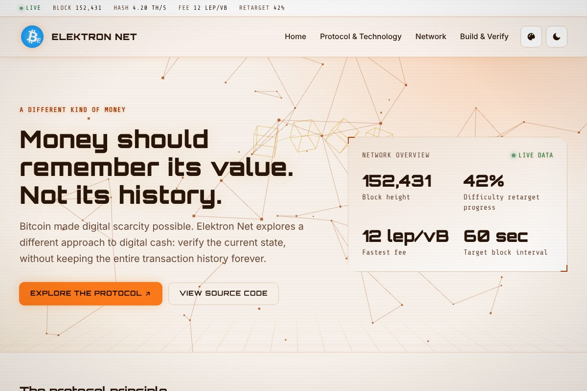

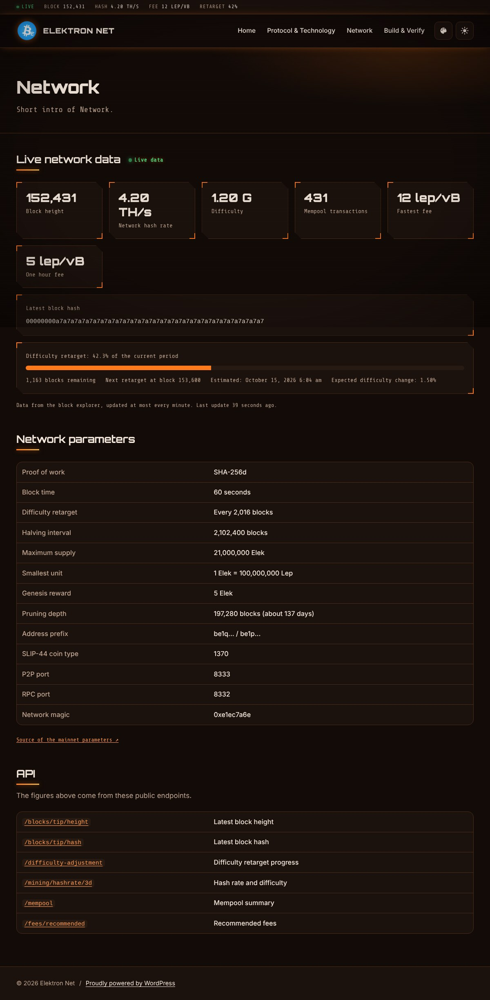

### Iron

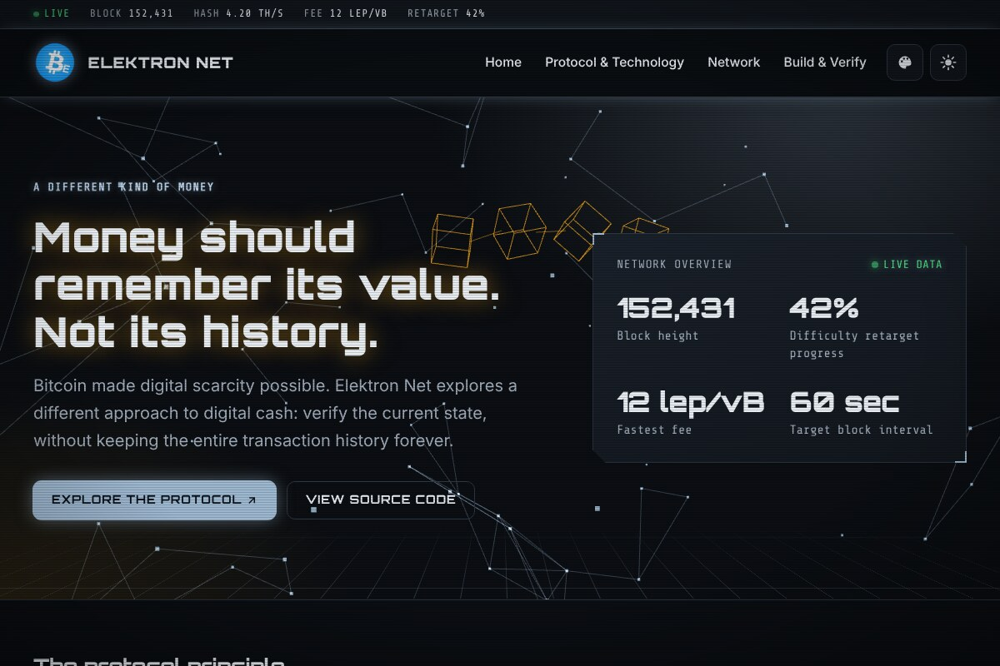

### Violet Night

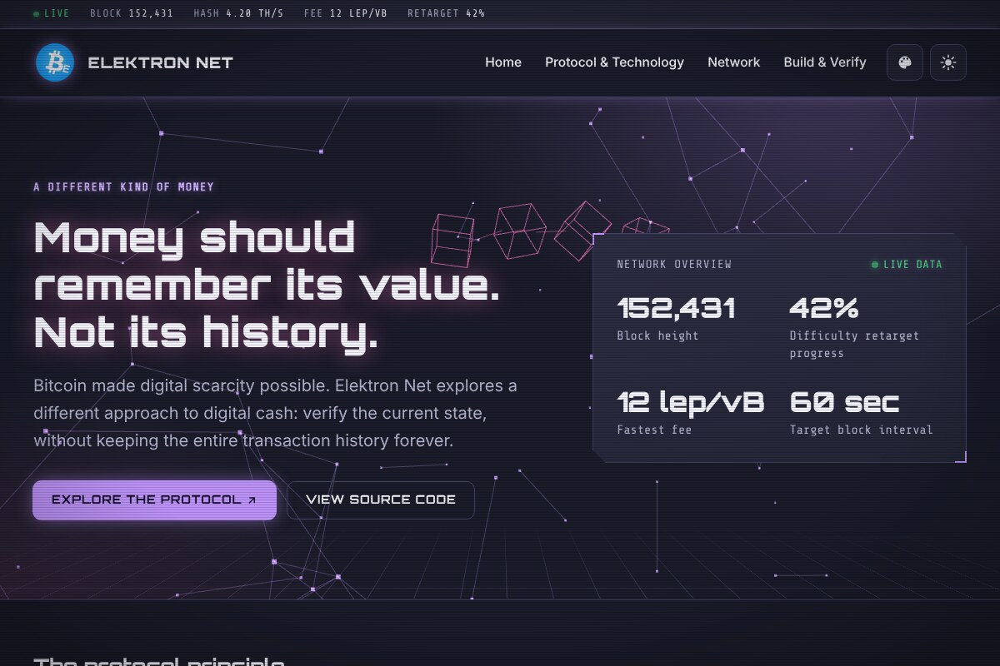

## 4. Live data

- Default explorer API: `https://mempool.elektron-net.org/api/v1` (HTTPS only).
- Change it under Settings > Elektron Live Blocks. The cache lifetime is 30 to 600 seconds (default 60).
- The web server requests the data. Visitors never contact the explorer.
- Endpoints used: `/blocks/tip/height`, `/blocks/tip/hash`, `/difficulty-adjustment`, `/fees/recommended`, `/mempool`, `/mining/hashrate/3d`, `/blocks`.
- When the explorer cannot be reached, the pages show that live data is unavailable. Placeholder numbers MUST NOT be displayed.
- Halving figures are calculated from the live block height with the protocol constants (2,102,400 blocks per halving, 5 Elek initial reward, 60 second target). The date is an estimate.

## 5. Development

```
npm install
npm run build
```

`npm run build` bundles `themes/elektron/assets/src/hero-network.js` and three.js into `themes/elektron/assets/js/hero-network.min.js`. The bundle MUST be rebuilt and committed after every change to the source file.

## 6. Quality checks

Last run on WordPress 7.1.3 (SQLite), PHP 8.3:

| Check | Tool | Result |
|---|---|---|
| Theme guidelines | Theme Check plugin (10,991 tests) | Passed, recommendations only |
| Plugin guidelines | Plugin Check, all categories (general, plugin repo, security, performance, accessibility) | No errors, no warnings |
| Coding standards and security | PHP_CodeSniffer with `WordPress-Extra` and `WordPress-Docs` | Clean |
| Accessibility | axe-core (WCAG 2.2 AA and best practices), 9 page types, dark and light, all 7 color themes | No violations |
| Editor | Block editor smoke test with all blocks | No script errors |

PHP 7.4 compatibility was checked statically with `PHPCompatibilityWP` (`--runtime-set testVersion 7.4-`). The only findings are the PHP 8.4 notice about the default characters of `trim()` and one hexadecimal-looking display string (`0xe1ec7a6e`), neither affects behavior.

## 7. Guidelines

- Escape all output, sanitize all input, and guard every PHP file with an `ABSPATH` check.
- Every user-facing string MUST use the text domain `elektron` (theme) or `elektron-live-blocks` (plugin).
- Scripts and styles MUST be bundled locally. No CDN, fonts or tracking from third parties.
- Content features such as blocks and shortcodes belong in the plugin, never in the theme.
- Protocol values on the site MUST match `src/kernel/chainparams.cpp` in the reference implementation.

## 8. License

Both packages are licensed under the GNU GPL v2 or later (see the `LICENSE` file in each folder). The theme bundles [three.js](https://threejs.org) under the MIT license (`themes/elektron/assets/js/three.LICENSE.txt`).

## 9. Links

- Website: https://elektron-net.org
- X (Twitter): @elektronnet and @kutlusoy
- Telegram: @elektronnet

## 10. Checklist

- [ ] Hero bundle rebuilt after source changes
- [ ] Version number identical in `style.css`, `readme.txt` and `functions.php` of the theme
- [ ] Version number identical in the plugin header, `readme.txt` and `block.json` files
- [ ] Translation template `languages/elektron.pot` updated after string changes
- [ ] Protocol values compared with `chainparams.cpp`
- [ ] Live blocks tested against the running explorer
