# Elektron Net: `osclass-elektron` Osclass Theme

- **Version:** 1.0.0 (draft)
- **Date:** October 14, 2026
- **Audience:** Site owners and developers who run an Osclass classifieds site in the Elektron look
- **Reference implementation:** [`elektron-net-wp`](https://github.com/kutlusoy/elektron-net-wp) (`themes/elektron/`), the WordPress theme whose color themes and effects this theme mirrors
- **Fork base:** [`Osclass`](https://github.com/osclass-classifieds/Osclass) Sigma theme structure, Apache License 2.0
- **Consumer:** [`elektron-net-osclass`](https://github.com/kutlusoy/elektron-net-osclass), the repository of the escrow plugin this theme styles
- **See also:** [`README.md`](../README.md)

---

## 1. Contents

| Path | What it is |
|---|---|
| `osclass-elektron/` | The theme. The folder name inside `oc-content/themes/` MUST stay `osclass-elektron`. |
| `../screenshots/osclass-elektron/` | Preview images taken from a real Osclass 8.4 installation. They are not part of the theme package. |

## 2. Installation

1. Pack `osclass/osclass-elektron` as a zip file. The folder name inside the zip MUST stay `osclass-elektron`.
2. Upload it under Appearance > Themes > Add new theme in the Osclass admin, or copy the folder to `oc-content/themes/`.
3. Activate **Osclass Elektron**. The first activation stores the default style options.
4. Optional: upload a logo under Appearance > Header logo. Without an upload the theme shows the Elektron mark and the site title.

Requirements: Osclass 8.x, PHP 7.4 or newer.

## 3. Color themes, variations and effects

The theme ships with the same seven color themes as the WordPress theme, each in a dark and a light variant.

| Color theme | Idea |
|---|---|
| Elektron Blue | The blue of the logo, the default |
| Neon Grid | Cyan and magenta on near black |
| Synthwave | Hot pink, violet and amber |
| Matrix | Terminal green on black |
| Rust | Rusty orange and brass |
| Iron | Steel and graphite with hazard amber |
| Violet Night | Soft violet and pink |

| Variation | Options |
|---|---|
| Color scheme | Dark, Light, Follow system |
| Effects | Off, Subtle (glow, HUD brackets, accent lines, faint grid), Full cyberpunk (scanlines, glitch headline, cut corners, Orbitron and Share Tech Mono) |
| Home hero | 3D blockchain and escrow (WebGL, default), Animated network (lightweight 2D), Perspective grid, Minimal |
| Glow of the 3D hero | Off, Subtle, Medium (default), Strong |
| Padlock style | Drawn icon (default), System emoji |
| Hero animation | Always animate (default), Respect the reduced motion setting |
| Corner style | Rounded, Sharp |
| Header | Glass and sticky, Solid and static |

Site owners pick the defaults under Appearance > Theme settings. Visitors can switch the color theme, the effects and the light or dark scheme in the header. The choice is remembered in their browser. The CSS animations (glitch headline, moving grid floor) stop for visitors who prefer reduced motion.

### Hero animation

The default hero is the three.js scene of the WordPress theme, extended for a marketplace: a drifting node network, a chain of linked blocks and an escrow vault. Buyer and seller sit left and right of the vault and payments travel into it. Floating blocks carry padlocks: closed ones glow red (funds locked in escrow), open ones glow green (released). The padlocks are flat, rounded icons drawn by the theme and look the same on every device. Under Theme settings > Padlock style the owner can switch to the system emoji instead, which shows the Apple look on iPhone and Mac. Where the device has no emoji font, the drawn icon is used. On the dark scheme the scene is rendered with the three.js bloom post-processing (`UnrealBloomPass`), so every line, node, block and padlock glows in its own color. The strength is set under Theme settings > Glow of the 3D hero animation (Off, Subtle, Medium, Strong). The light scheme renders the same scene without bloom, because a glow needs a dark background. The scene follows the active color theme and scheme, reacts to the pointer, pauses when it is off screen and runs on phones and tablets as well. Devices with a reduced motion setting get the scene at half speed. Under Theme settings > Hero animation the site owner can switch to respecting that setting, the scene then shows one still frame. If WebGL is not available the lightweight 2D network takes over. Pick another hero under Appearance > Theme settings.

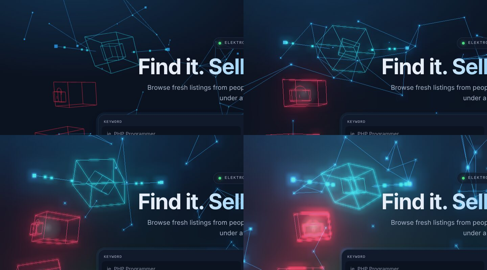

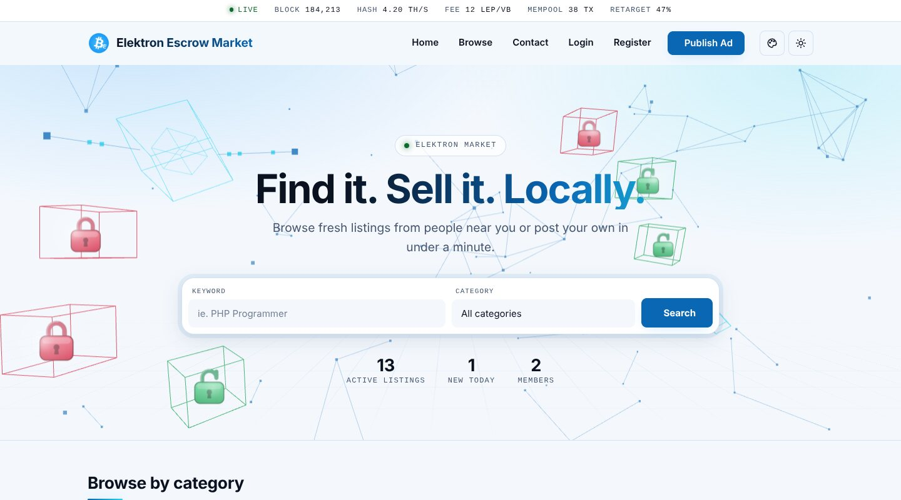

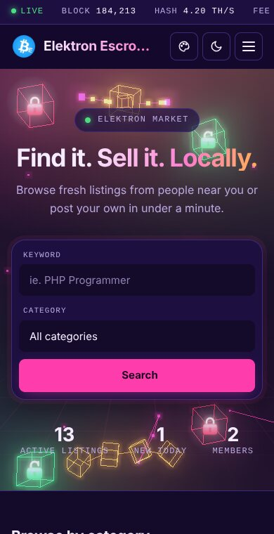

### Previews

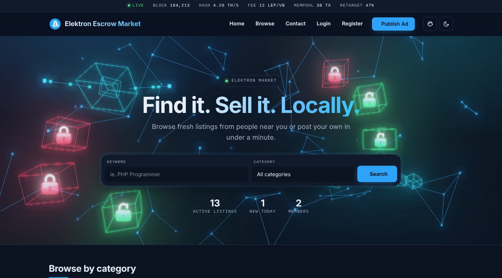

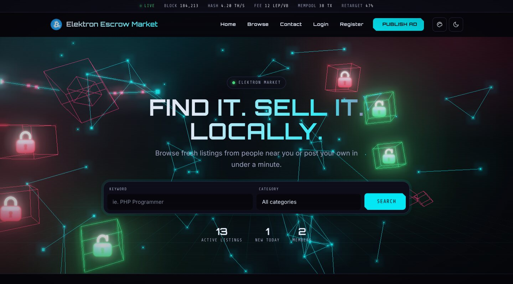

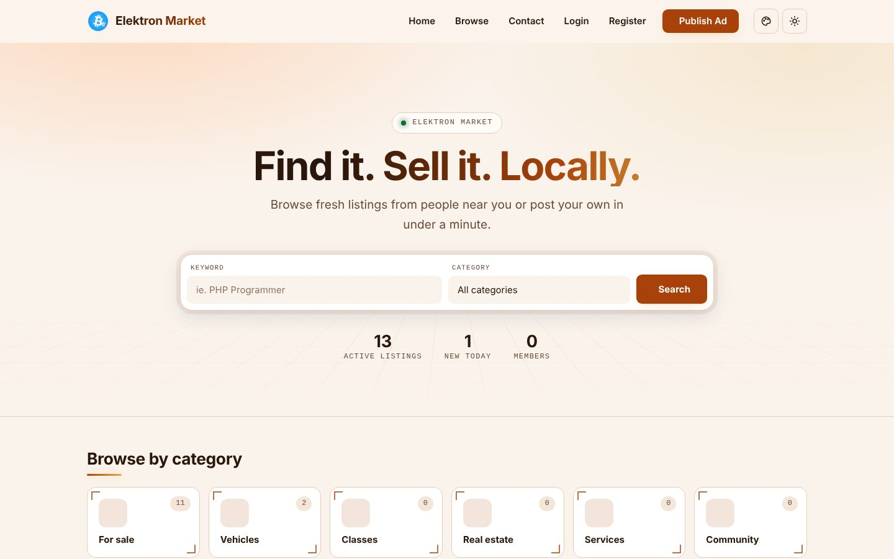

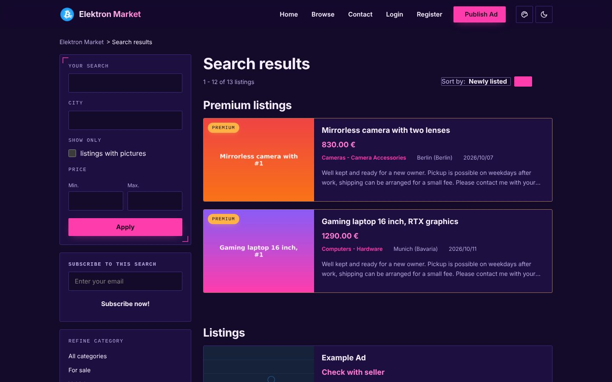

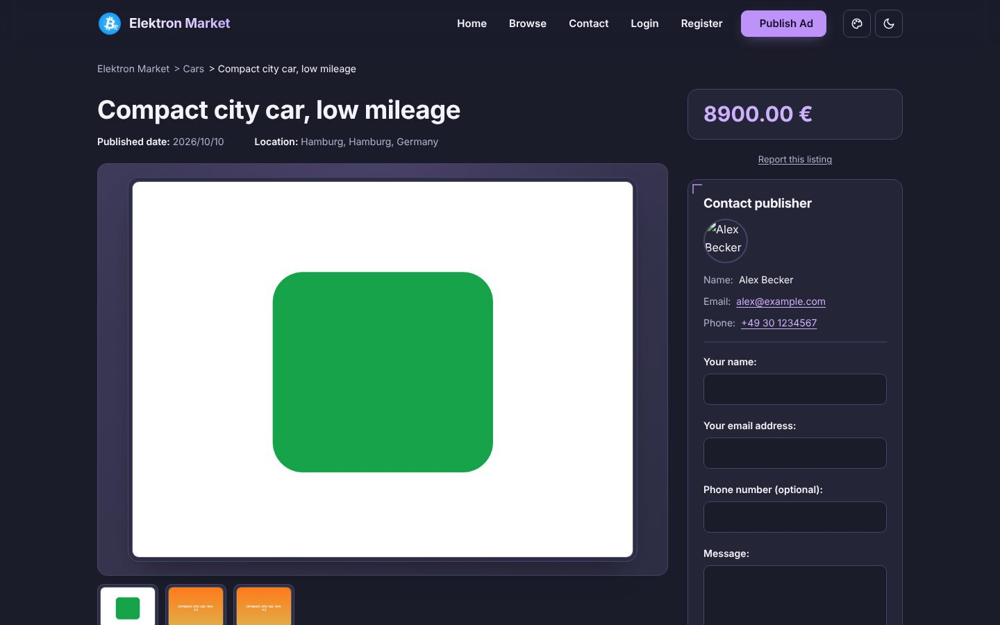

## 4. Photo frames

Every listing photo sits in a framed mat: a padded surface with a thin inner ring and a soft shadow. Photos with a white background keep a clean, defined edge on dark and light schemes and in every color theme. The same frame is used for the main photo and the thumbnails on the listing page. Listings without a photo show a neutral placeholder.

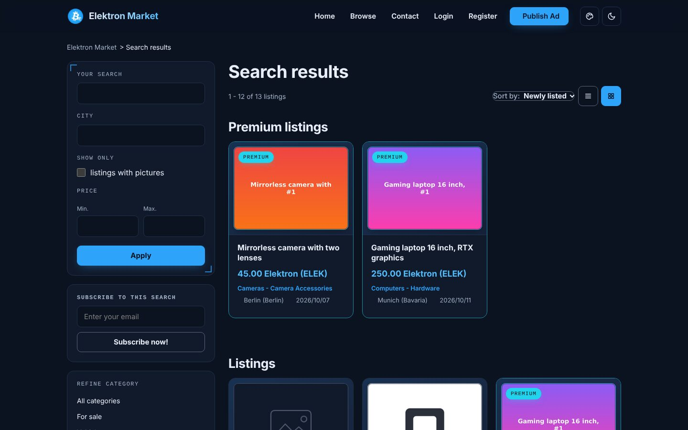

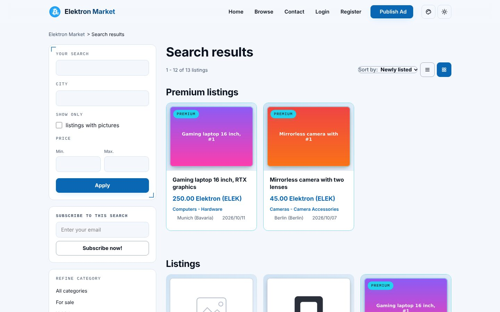

## 5. Elektron Net Escrow plugin

The theme styles the pages of [`osclass-escrow`](https://github.com/kutlusoy/elektron-net-osclass/tree/main/osclass-escrow) (wallet connection, checkout, order status, order list) with `css/escrow.css`. The stylesheet loads only while the plugin is active and needs no change in the plugin. The plugin's inline styles use fixed light colors, so the theme overrides them with its own tokens. They follow the active color theme, scheme and corner style. The "Buy with Elektron (ELEK)" widget appears on the listing page, and the account menu shows the orders and wallet links with icons.

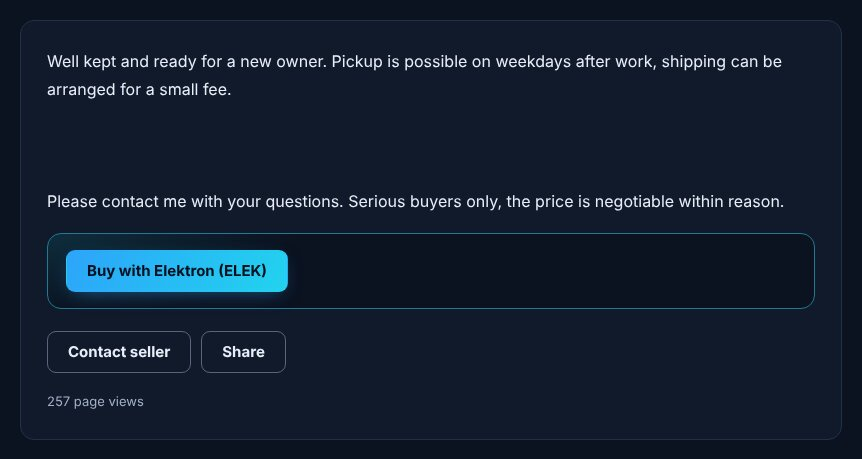

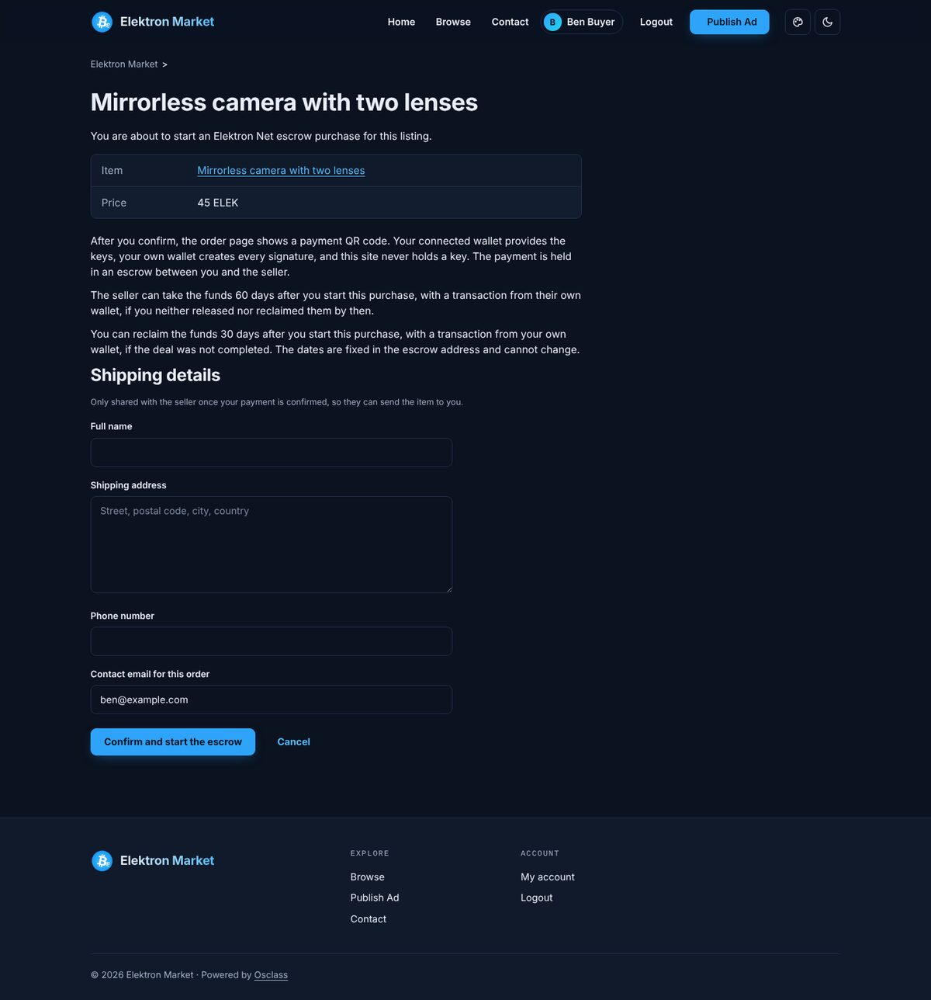

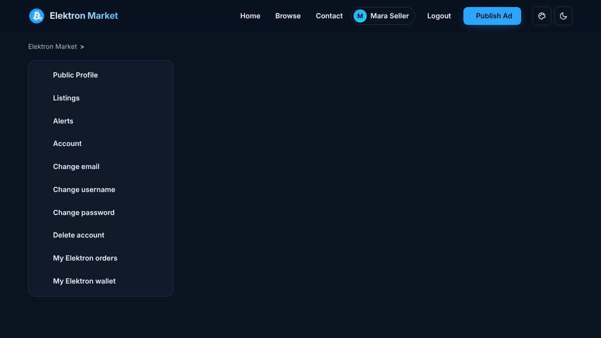

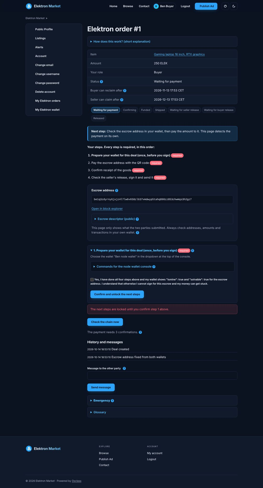

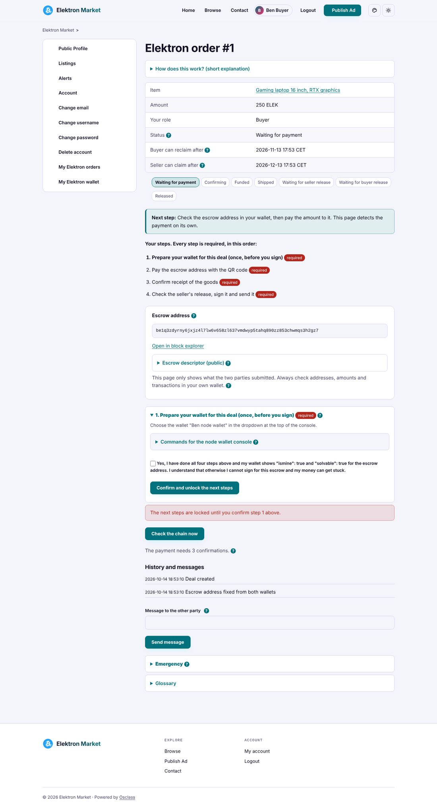

## 6. Theme settings

Appearance > Theme settings contains the style options above, the hero title and text, the search placeholder, the default listing view (list or gallery), the location input mode and the ad slots. All Osclass hooks of the Sigma theme are kept, so existing plugins keep working.

## 7. Network status bar

A slim bar above the header shows live figures of the Elektron Net chain, centered: block height, hash rate, fee, mempool size and retarget progress. The word Live links to the explorer website.

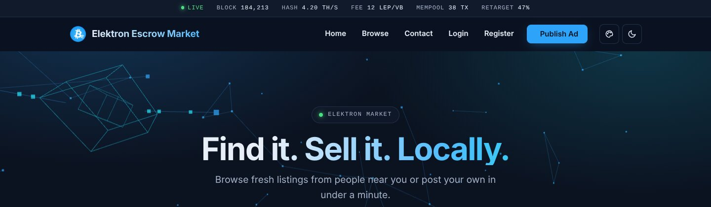

- The default source is `https://mempool.elektron-net.org/api/v1`. It is built in and used whenever the list below is empty.
- Appearance > Theme settings > Network status bar holds the list of sources, one API address per line, HTTPS only, at most 8. The sources are tried from top to bottom and the first one that answers is used, the lines after it are fallbacks.
- The web server requests the data, visitors never contact the explorer. Answers are cached for 30 to 600 seconds (default 60) in `oc-content/uploads`. When the cache expires, one request refreshes it while other visitors still get the previous values. Values older than one hour are dropped.
- Endpoints used: `/blocks/tip/height`, `/difficulty-adjustment`, `/fees/recommended`, `/mempool`, `/mining/hashrate/3d`. When no source answers, the bar is hidden. Placeholder numbers MUST NOT be displayed.
- Sources that resolve to private or reserved addresses are skipped. A site that runs its explorer in a private network can allow it with the filter `elektron_network_allow_host`.

## 8. Logo

The header and the footer show the logo image and a text next to it. The image is the logo uploaded under Appearance > Header logo, without an upload the bundled Elektron mark is used. The text is set in Appearance > Theme settings > Logo text and falls back to the site title when empty. "Show logo text" turns the text off for logos that already contain the name.

## 9. Development

The WebGL scene lives in `osclass-elektron/js/src/hero-three.js` and is bundled with three.js into `js/hero-three.min.js`. From the repository root run `npm install` once, then `npm run build:osclass`. The bundle MUST be rebuilt and committed after every change to the source file. `npm run build:all` also rebuilds the WordPress hero.

## 10. Notes

- Category icons use Font Awesome 5 classes, loaded from cdnjs as in the Sigma theme. The header controls use inline SVG and work without it.
- Fonts for the full effect level are bundled in `fonts/` (SIL Open Font License). three.js is MIT licensed, see `js/three.LICENSE.txt`.
- The theme is derived from the Sigma theme of Osclass and keeps the Apache License 2.0, see `osclass-elektron/LICENSE`.
